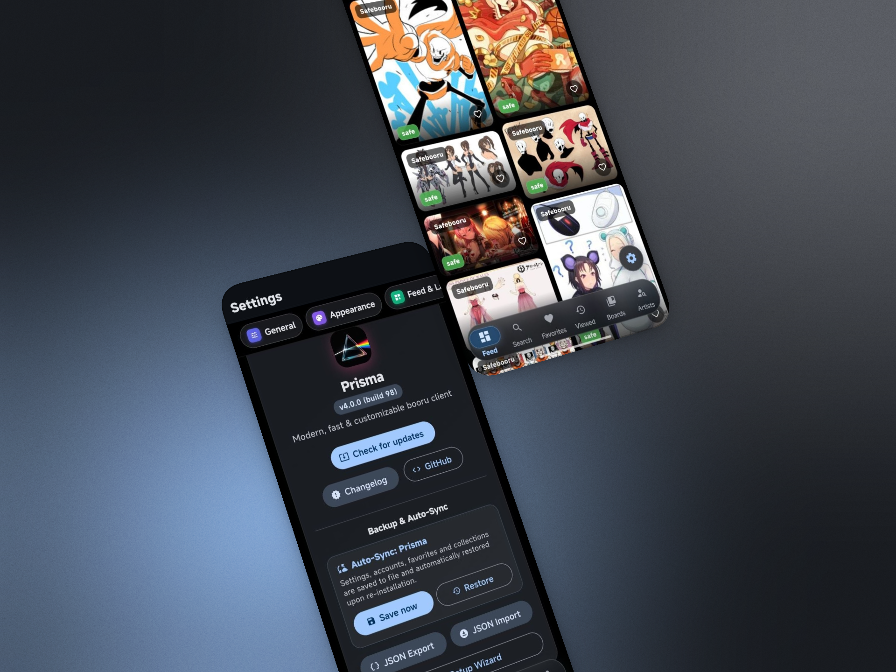

<p align="center">
  <a href="https://github.com/RarDog/Prisma">
    
  </a>
</p>

<h1 align="center">Prisma</h1>

<p align="center">
  <strong>Next-generation, high-performance multimedia client for Booru imageboards, creator archives, manga catalogs, and light novel libraries.</strong>
</p>

<p align="center">
  <strong>English</strong> • <a href="README_RU.md">Русский</a>
</p>

<p align="center">
  <a href="https://github.com/RarDog/Prisma/releases/latest"></a>
  
  
  <a href="LICENSE"></a>
  <a href="https://github.com/RarDog/Prisma/issues"></a>
</p>

<p align="center">
  
</p>

---

## Overview

**Prisma** is a modern, privacy-focused, resource-optimized multimedia application engineered with Flutter. It unifies dozens of popular booru imageboards, artwork archives, manga platforms, and light novel repositories into a fluid Material 3 interface across mobile and desktop environments.

Built from the ground up for low latency, smooth 60/120 FPS navigation, and predictable memory footprint, Prisma handles multi-gigabyte media collections without interface stutter or out-of-memory crashes.

---

## ⚡ Key Highlights

* **Proactive Feed Prefetching**: Intelligent viewport preloading buffers subsequent media pages seamlessly ahead of scroll velocity.
* **Hardware-Accelerated Video Engine**: Integrated `media_kit` (libmpv) player tuned for minimal Time-to-First-Frame (TTFF) and low-latency WebM/MP4 playback.
* **Extensive Ecosystem**: Native support for over 15 imageboards, manga scanlations, light novel libraries, and creator networks.
* **Deterministic Sliding-Window Memory**: Aggressive $\pm 1$ page eviction isolates memory consumption to active viewports.
* **Live Network Diagnostics**: Monotonic hardware stopwatch RTT measurements, streaming health telemetry, and automatic offline fail-safe.
* **Adaptive Glass UI & Layouts**: Customizable navigation rail (Left / Right / Bottom), AMOLED black, and Liquid Glass Material 3 themes.

---

## 🚀 Core Capabilities

### 📱 Media & Feed Browsing
* **Adaptive Viewport Modes**: Continuous Pinterest-style masonry grid, 1:1 square cards, and dense compact lists.
* **Dynamic Resolution Profiles**: Configure image fidelity per environment — *Auto*, *Data Saver / Preview*, *Sample / Balanced*, or uncompressed *Original*.
* **Deep Zoom & High-Fidelity Viewer**: Multi-touch interactive zoom, pan gesture physics, asset variants switcher, and Danbooru-style translation notes overlay.
* **Post Sets & Manga Navigation**: Multi-page artwork indicator on feed cards and dedicated bottom page-stepper strip for sequential works.

### 📚 Manga & Light Novel Hub
* **Integrated Global Catalogs**: Instant streaming and reading from **MangaDex**, **MangaLib**, and **RanobeLib**.
* **Specialized Reading Pipelines**:
  * **Webtoon Mode**: Frictionless continuous vertical strip with hardware-accelerated image decoding.
  * **Manga Reader**: Traditional Right-to-Left (RTL) and Left-to-Right (LTR) page layouts with custom margin tuning.
  * **Light Novel Typography**: Dedicated formatting engine with adjustable typeface, font size, line spacing, and eye-friendly color themes.
* **Reading Progress Synchronization**: Automated bookmarking, unread tracking, and library organization (*Reading*, *Plan to Read*, *Completed*, *On Hold*, *Dropped*).

### 🔍 Search & Intelligent Filtering
* **Sub-Millisecond Tag Autocomplete**: Instant token suggestions queried across millions of booru tags.
* **Advanced Query Syntax**: Multi-tag search, boolean exclusion (`-tag`), explicit `and` conjunctions, and source switching without resetting query parameters.
* **Three-Tier Content Control**: Flexible blacklist, whitelist, NSFW auto-blur, and quick toggle between Safe and Unrestricted modes.
* **Creator Hub**: Direct author profiles, portfolio browsing, and creator archive indexing.

### 🛡️ Resource Optimization & Diagnostics
* **Smart Memory GC & Watchdog**: Proactively intercepts OS low-memory warnings, releasing decoded raster surfaces before memory thresholds trigger process termination.
* **Sliding-Window Eviction**: Ensures carousel memory bounds never exceed active neighbors ($\pm 1$), evicting distant decoders.

---

## 🌐 Supported Sources & Feature Matrix

| Source | Category | Integration Type | Video | Tags & Autocomplete | Comments | Period Filters |
| :--- | :--- | :--- | :---: | :---: | :---: | :---: |
| **Danbooru** | Booru | Native REST JSON | ✅ | ✅ | ✅ | ✅ |
| **Gelbooru** | Booru | DAPI JSON | ✅ | ✅ | ❌ | ✅ |
| **The Big ImageBoard (TBIB)** | Booru | DAPI JSON | ✅ | ✅ | ❌ | ✅ |
| **Konachan** | Booru | Moebooru API | ❌ | ✅ | ✅ | ✅ |
| **Yande.re** | Booru | Moebooru API | ❌ | ✅ | ✅ | ✅ |
| **e621 / e926** | Furry / Booru | Native REST JSON | ✅ | ✅ | ✅ | ✅ |
| **Pixiv** | Art & Sets | Session Auth / REST | ❌ | ✅ | ✅ | ✅ |
| **Wallhaven** | 4K/8K Wallpapers | REST API | ❌ | ✅ | ❌ | ✅ |
| **Rule34 (.xxx)** | Booru | Gelbooru API | ✅ | ✅ | ❌ | ✅ |
| **Rule34.us** | Booru | Resilient HTML Scraper | ✅ | ✅ | ❌ | ✅ |
| **Rule34 Paheal** | Booru | Shimmie HTML Scraper | ✅ | ✅ | ❌ | ❌ |
| **Realbooru** | Booru | HTML Scraper | ✅ | ✅ | ❌ | ❌ |
| **Safebooru** | Booru (SFW) | Gelbooru API | ❌ | ✅ | ❌ | ✅ |
| **XVideos** | Video Tube | HTML Scraper | ✅ | ✅ | ❌ | ✅ |
| ~~**Fapello**~~ | ~~Creator Media~~ | ~~Scraper Engine~~ | ~~✅~~ | ~~❌~~ | ~~❌~~ | ~~❌~~ |
| ~~**Are.na**~~ | ~~Channels & Blocks~~ | ~~REST API~~ | ~~❌~~ | ~~❌~~ | ~~❌~~ | ~~❌~~ |
| **Pawchive** | Creator Archives | Direct Sync | ✅ | ✅ | ❌ | ❌ |
| **MangaDex** | Manga | REST API | — | ✅ | ❌ | Multi-Lang |
| **MangaLib** | Manga | REST / Web API | — | ✅ | ❌ | Volumes |
| **RanobeLib** | Light Novels | REST / Web API | — | ✅ | ❌ | Chapters |

---

## 📦 Download & Platform Availability

All pre-compiled packages are hosted on the official **[Releases](https://github.com/RarDog/Prisma/releases)** page.

### 🎯 Release Candidate (`v4.2.1-rc.2`)

#### 📱 Android (RC)
| Package | Architecture | Target Devices |
| :--- | :--- | :--- |
| **[Prisma-4.2.1-rc.2-arm64-v8a.apk](https://github.com/RarDog/Prisma/releases/download/v4.2.1-rc.2/Prisma-4.2.1-rc.2-arm64-v8a.apk)** | 64-bit ARM (`arm64-v8a`) | Modern smartphones and tablets (Android 7.0+) |
| **[Prisma-4.2.1-rc.2-armeabi-v7a.apk](https://github.com/RarDog/Prisma/releases/download/v4.2.1-rc.2/Prisma-4.2.1-rc.2-armeabi-v7a.apk)** | 32-bit ARM (`armeabi-v7a`) | Legacy or entry-level 32-bit devices |
| **[Prisma-4.2.1-rc.2-x86_64.apk](https://github.com/RarDog/Prisma/releases/download/v4.2.1-rc.2/Prisma-4.2.1-rc.2-x86_64.apk)** | 64-bit x86 (`x86_64`) | Android emulators, ChromeOS, and x86 devices |

#### 🐧 Linux (RC)
| Package | Format | Notes |
| :--- | :--- | :--- |
| **[Prisma-v4.2.1-rc.2-linux-x86_64.AppImage](https://github.com/RarDog/Prisma/releases/download/v4.2.1-rc.2/Prisma-v4.2.1-rc.2-linux-x86_64.AppImage)** | AppImage | Standalone portable executable (requires `libmpv`) |
| **[Prisma-v4.2.1-rc.2-linux-x64.tar.gz](https://github.com/RarDog/Prisma/releases/download/v4.2.1-rc.2/Prisma-v4.2.1-rc.2-linux-x64.tar.gz)** | Tarball Archive | Portable application bundle |

---

### 🏆 Stable Channel (`v4.2.0`)
Production-ready milestone releases recommended for everyday stability across all platforms.

| Platform | Package | Architecture / Format |
| :--- | :--- | :--- |
| **Android** | **[Prisma-4.2.0-arm64-v8a.apk](https://github.com/RarDog/Prisma/releases/download/v4.2.0/Prisma-4.2.0-arm64-v8a.apk)** | 64-bit ARM (Recommended) |
| **Android** | **[Prisma-4.2.0-armeabi-v7a.apk](https://github.com/RarDog/Prisma/releases/download/v4.2.0/Prisma-4.2.0-armeabi-v7a.apk)** | 32-bit ARM (Legacy) |
| **Android** | **[Prisma-4.2.0-x86_64.apk](https://github.com/RarDog/Prisma/releases/download/v4.2.0/Prisma-4.2.0-x86_64.apk)** | 64-bit x86 (Emulators) |
| **Linux** | **[Prisma-v4.2.0-linux-x86_64.AppImage](https://github.com/RarDog/Prisma/releases/download/v4.2.0/Prisma-v4.2.0-linux-x86_64.AppImage)** | Standalone AppImage |
| **Linux** | **[Prisma-v4.2.0-linux-x64.tar.gz](https://github.com/RarDog/Prisma/releases/download/v4.2.0/Prisma-v4.2.0-linux-x64.tar.gz)** | Portable Tarball |
| **Windows** | **[Prisma-v4.2.0-windows-x64.zip](https://github.com/RarDog/Prisma/releases/download/v4.2.0/Prisma-v4.2.0-windows-x64.zip)** | Portable 64-bit ZIP Archive |
| **macOS** | **[Prisma-v4.2.0-macos.zip](https://github.com/RarDog/Prisma/releases/download/v4.2.0/Prisma-v4.2.0-macos.zip)** | Standalone macOS App Bundle (`Prisma.app`) |

---

## 🏗️ Architecture & Technology Stack

Prisma follows a modular, reactive architecture based on Clean Architecture principles:

```
┌────────────────────────────────────────────────────────┐
│               Presentation Layer (UI)                  │
│   Material 3 • Responsive Breakpoints • Liquid Glass   │
└───────────────────────────▲────────────────────────────┘
                            │ Riverpod State Management
┌───────────────────────────┴────────────────────────────┐
│                    Domain & Logic                      │
│   Feed Controllers • Search State • Prefetch Engine    │
└───────────────────────────▲────────────────────────────┘
                            │ Repository Contracts
┌───────────────────────────┴────────────────────────────┐
│               Data, Storage & Core Engine              │
│  Isar DB (NoSQL) • media_kit (libmpv) • Dio HTTP Pool │
└───────────────────────────▲────────────────────────────┘
                            │ Network Connectors
┌────────────────────────────────────────────────────────┐
│     Remote Sources (REST • DAPI • Scrapers • Auth)     │
└────────────────────────────────────────────────────────┘
```

* **Framework**: [Flutter](https://flutter.dev) (Dart 3.3+)
* **State Management**: [Riverpod 2.6](https://riverpod.dev)
* **Embedded Database**: [Isar Database](https://isar.dev) (High-performance NoSQL)
* **Media Decoding**: [media_kit](https://github.com/media-kit/media-kit) (libmpv C-bindings)
* **Networking**: [Dio](https://pub.dev/packages/dio) with HTTP keep-alive connection pooling

---

## 🛠️ Building from Source

### Prerequisites
* [Flutter SDK](https://flutter.dev/docs/get-started/install) (`>= 3.24.0`)
* [Dart SDK](https://dart.dev/get-dart)
* JDK 17 & Android Command Line Tools (for Android compilation)
* Linux host dependencies:
  ```bash
  sudo apt-get install -y clang cmake ninja-build pkg-config libgtk-3-dev libmpv-dev liblzma-dev
  ```

### Build Commands
```bash
# 1. Clone repository
git clone https://github.com/RarDog/Prisma.git
cd Prisma

# 2. Fetch dependencies
flutter pub get

# 3. Launch in debug mode
flutter run

# 4. Compile Android Split APKs
flutter build apk --release --split-per-abi

# 5. Compile Linux Desktop Release
flutter build linux --release
```

---

## 🤝 Contributing & Issue Reporting

Contributions, ideas, and feedback are always welcome!
* Encountered a bug or performance bottleneck? Please submit an issue via the **[GitHub Issue Tracker](https://github.com/RarDog/Prisma/issues)**.
* Have an idea for a new content source or feature? Open a feature request with sample endpoints or markup.

---

## 📄 License

Prisma is open-source software licensed under the [MIT License](LICENSE).
